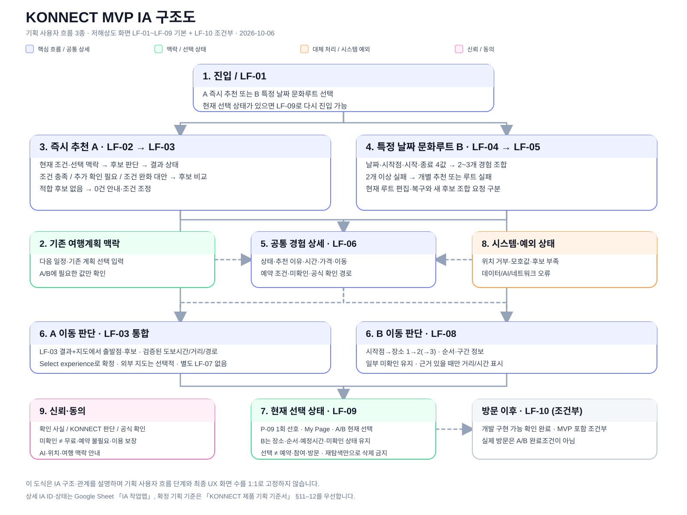
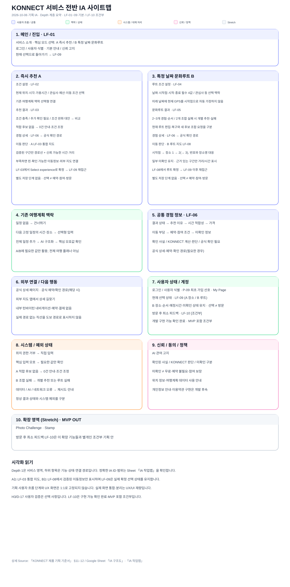

# KONNECT · 프로젝트 요약과 팀 작업 시작점

상단은 서비스 전체 윤곽과 현재 상태를 설명합니다. 상세 작업은 아래 [담당자별 읽기 경로](#담당자별-읽기-경로)와 주제별 문서 지도를 이용하세요.

## KONNECT 한눈에 보기

**KONNECT는 서울 자유여행 중 주어진 시간 안에 어떤 문화경험을 실제로 할 수 있을지 고민하는 외국인 여행자에게, 위치·날짜·가용시간과 운영조건을 확인해 실제 선택 가능한 문화경험을 빠르게 좁혀주는 서비스다.**

- **문제:** 서울의 문화정보는 여러 채널에 존재하지만, 외국인 자유여행자가 위치·시간·운영조건·가격·예약조건 등을 함께 비교해 현재 자신에게 실제 선택 가능한 문화경험을 판단하기 어렵다.
- **핵심 가치:** 개인화 추천 자체보다 **현재 사용자 조건에서 실제 가능한 문화경험을 확인해 선택을 좁힌다.**
- **신뢰 원칙:** **미확인 ≠ 무료 / 예약 불필요 / 이용 가능 보장.** 확인되지 않은 정보는 추정하지 않는다.

## 대표 사용자와 검증 범위

| 구분 | 기준 |
|---|---|
| 서비스 전체 타깃 | 특정 국적·연령으로 제한하지 않은 서울 자유여행 외국인 FIT(개별 자유여행객). 스마트폰으로 스스로 검색·이동할 수 있는 상황·행동 기반 사용자를 중심으로 한다. |
| 대표 검증 Persona | **서울을 한 번 이상 방문한 외국인 FIT**를 대표 시나리오로 두되, 재방문 경험이 지명·교통·문화시설 숙련을 뜻한다고 가정하지 않는다. 혼자 여행을 대표로 두지만 소규모 동행도 포함하며, 서비스 전체는 첫 방문 FIT도 제외하지 않는다. 문화경험을 원하지만 구체 장소는 정하지 않았고 자유시간·특정 날짜의 빈 시간 안에서 실제 가능한 선택을 빠르게 좁히고 싶다. **2~4시간은 대표 검증 시나리오이지 서비스 제약이 아니다.** |
| 우선 검증 타깃 | 4주 MVP 초기 검증에서는 **영어 사용에 익숙한 미국 20~40대 FIT**를 우선 검증군으로 둔다. 비교적 일관된 사용자군으로 핵심 사용 흐름과 영어 UI를 검증하기 위한 범위이며, 서비스 전체 타깃을 제한하지 않는다. |
| 우선 검증 지역 | **서울 도심 문화권**. 서울 전체 완전 커버는 MVP 범위에 포함하지 않는다. |

**영어 우선 이유:** 특정 영어권 국가만을 타깃으로 하기 때문이 아니라, 4주라는 제한된 개발기간 안에서 다국어 동시 구현을 피하고 폭넓게 활용 가능한 하나의 언어로 MVP를 완성하기 위한 우선순위 결정이다.

## User Story

> 서울을 자유여행하는 외국인으로서, 내가 사용할 수 있는 시간과 현재 조건에 맞는 문화경험을 빠르게 좁히거나 연결해, 여러 정보를 직접 비교하지 않고 다음 문화경험 또는 문화루트를 결정하고 싶다.

## 핵심 기능

| 구분 | 사용 상황과 제공 가치 |
|---|---|
| **즉시 추천(A)** | “지금 바로 어떤 문화경험을 할 수 있을까?” 현재 위치·시각·가용시간을 기준으로 시작하고, 관심사·예산·이동조건·기존 여행계획 등을 선택적으로 반영해 실제 선택 가능한 문화경험을 소수 후보로 좁힌다. |
| **특정 날짜 문화루트(B)** | “반나절 정도 시간을 어떻게 문화경험으로 채울까?” **특정 날짜 + 시작점 + 시작 시각 + 종료 경계**를 확인해 문화경험 **2~3개를 방문 순서가 있는 루트 1개로 연결**한다. |
| **기존 여행계획 · 공통 선택 정보** | 사용자가 이미 정해둔 일정은 **즉시 추천(A)·특정 날짜 문화루트(B) 추천에 선택적으로 반영하는 공통 정보**다. 다음 고정 일정의 시간·장소부터 간편하게 입력하고, 필요하면 전체 일정을 확장 입력한다. 기존 계획이 없는 사용자도 바로 즉시 추천(A)·특정 날짜 문화루트(B)를 이용할 수 있다. |

즉시 추천(A)의 현재 위치·시각은 변경 가능한 기본값이다. 원래 있던 자유시간과 예상치 못한 빈 시간을 모두 포함하며, **2~4시간은 검증 시나리오 예시이지 이용조건이 아니다.** 특정 날짜 문화루트(B)의 시작점은 해당 날짜에 출발할 위치와 시각을 뜻한다.

## 서비스가 작동하는 방식

| 단계 | 서비스 동작 |
|---|---|
| **입력** | A는 시작 위치·시작 시각·종료 시각을 구조화하고 선택조건은 하나의 자연어 영역에서 보완한다. B의 LF-04는 **Guided Chat 3+1**(`S1 Start → S2 Clarification → S3 Ready to generate + V1 Direct edit·Ambiguity`)을 대표 상태로 하며, 자연어 대화를 우선하되 강제하지 않는다. **날짜·시작점·시작 시각·종료 경계 4값** 중 누락·모호한 값만 확인하고, compact editable summary·Quick Select·직접 수정은 보조 경로로 사용한다. 4값 확인 후에만 문화루트를 생성한다. 실제 날씨는 API Context, 날씨 관련 선호는 선택 입력이다. |
| **판단** | 운영일·시간·가격·예약·참여조건·이동 부담 등 확인 가능한 정보를 사용자 조건과 함께 판단한다. **필수 조건 충돌은 제외**하고 조정 가능한 선호는 우선순위에 반영한다. |
| **결과** | 즉시 추천(A)은 소수 문화경험, 특정 날짜 문화루트(B)는 2~3개 문화경험의 루트 1개를 제공한다. 사용자에게 보이는 상태는 **조건 충족 / 추가 확인 필요 / 조건 완화 대안**이다. |
| **행동** | 추천 이유·시간 적합성·가격·이동 부담·예약·참여조건·공식 확인 경로를 확인하고 **장소 또는 루트를 선택**한다. `이 장소로 갈게요` / `이 루트로 갈게요`로 현재 선택 상태를 유지한다. |

확인된 사실, 계산·계획·AI 판단, 미확인을 구분한다. 신뢰 가능한 후보가 부족해도 숫자를 강제로 채우지 않으며, 특정 날짜 문화루트(B)에서 2개 이상을 연결할 수 없으면 개별 추천 또는 루트 구성 실패로 전환한다. 장소·루트 선택은 실제 방문이나 이용 가능 보장을 뜻하지 않는다.

## MVP 범위

| 구분 | 범위 |
|---|---|
| **MVP 포함** | 즉시 추천(A) / 특정 날짜 문화루트(B) / 기존 여행계획의 선택적 활용 / 로그인·상태관리 / My Page(개인화 관리·현재 여행/최근 선택 최소 진입·계정 정보) |
| **MVP 제외** | 전체 여행플래너 / 자체 실시간 내비게이션 / 서비스 내부 예약·결제 / 실시간 잔여좌석·실제 참여 가능 여부 보장 / Recovery / 서울 전체 완전 커버 / 모든 언어 동시 지원 |
| **추가 구현 후보 (Stretch)** | Photo Challenge + Stamp — 핵심 기능 완성 후 여력이 있을 때 검토 |
| **구현 전제** | Mobile-first Web / 영어 우선 / 서울 도심 문화권 우선 검증 |

로그인·상태관리는 **MVP IN**, 방식은 **Google Social Login 방향**이다. 첫 진입에서 로그인을 강제하지 않으며 **비회원은 첫 추천 결과까지 1회 이용하고, 두 번째 추천 또는 재추천 요청 시 로그인 유도**한다. B 첫 생성·검토·선택과 현재 루트 편집·복구·조건 수정 자체는 비회원 가능하며, 새 후보 조합 생성 직전에만 로그인을 유도한다([05 · B 로그인 적용 경계](./05-ux-handoff.md#b-로그인-적용-경계)). 비회원→로그인 시 현재 추천 흐름의 연속성을 유지하며 구체 이전·복원 방식은 Tech가 결정한다. **P-09**는 Google 최초 가입 시 1회만 노출하는 선택형 선호 온보딩으로, 관심사 6개 복수 선택과 걷기 등을 포함한 추가 선호 자유입력을 제공한다. 모두 미입력·Skip 가능하며, 자유입력은 LLM 해석 → 사용자 확인·수정 → 저장 후 선호로 활용한다. 직접 선택한 관심사의 AI 재해석은 필수가 아니며 기존 회원에게 반복 노출하지 않는다. 이동 관련 저장 선호는 **Soft ranking signal only**로 유지하고 현재 Request가 항상 우선하며 저장 선호만으로 M01/M02를 생성하지 않는다. 방문 후 최소 피드백은 기존 조건부 상태를 유지한다.

Social Proof·유료 배너는 향후 확장이며, BM은 [결정 색인의 BM Hypothesis v0](../decisions/decision-log.md)에서 가설로 구분한다.

## 문화경험 범위

<strong>'문화경험(Cultural Experience)'</strong>은 개별 추천 대상의 공식 공통명칭이다. 영문 UI에서는 문맥이 명확하면 `Experience / Experiences`로 줄일 수 있다.

5개 내부 유형은 **직접 참여 체험 / 공연 / 전시 / 문화·역사 장소 방문 / 축제·행사**다. 이는 콘텐츠 범위를 관리하는 내부 분류이며, 사용자 화면의 관심사 6개와 구분한다. 관심사는 선택·복수 선택 가능하고 미선택도 허용한다.

일반 식당·쇼핑·스포츠·레저는 제외한다. 팝업은 현재 안정적인 데이터 경로 부족으로 MVP에서 제외한다. 야외 여부는 별도 유형이 아닌 속성으로 다룬다.

## 데이터 전략

- **TourAPI:** 기본 데이터 소스.
- **서울문화포털 문화행사 API·KOPIS:** 행사·공연 등 문화정보 보완.
- **기상청·AirKorea:** 날씨·대기질을 추천 판단의 환경 정보로 활용.

API 접근 가능성과 실제 필드 품질은 구분한다. 가격·예약·시간의 결측·충돌을 임의로 메우지 않고, 확보된 공식 상세·예약·확인 경로로 연결한다. 지역기관 웹의 별도 자동수집·보완은 MVP에서 제외한다.

환경정보만으로 행사 취소를 추정하지 않는다. 공식 위험 특보·경보로 정상 추천이 부적절한 야외 경험은 제외하고 실내 대안을 우선하며, 행사 취소·운영변경은 공식 운영정보로 확인한다.

## AI · Tech 활용

AI는 단순 추천문 생성에 그치지 않고 다음 다단계 흐름에 활용한다.

**사용자 조건 구조화 → 필요한 정보 확인 → 결과에 따른 재판단 → 후보·루트 구성 → 추천 이유와 불확실성 설명**

Agent는 조회·도구 사용과 결과에 따른 다음 단계를 연결하는 방식, RAG는 검색한 근거를 생성에 활용하는 방식, Memory는 허용된 사용자 맥락을 저장·재사용하는 방식으로 이해할 수 있다.

**RAG 등의 기술을 활용할 수 있으며 구체 구성은 Tech가 결정한다.** Product가 Agent/RAG/Memory 조합을 필수 아키텍처로 고정하지 않는다. API 직접 조회는 데이터를 가져오는 방법이고 RAG는 조회한 근거를 생성에 활용하는 방식이므로 같은 개념이 아니다. RAG를 채택하지 않고 API 직접 조회나 다른 조회 방식을 사용해도, 필요한 다단계 동작·근거 확인·재사용 경계·신뢰 기준을 충족하면 Product 기준은 유지된다.

명백한 사실·제약 판정을 AI 추정으로 대체하지 않으며, 확인된 사용자 맥락만 허용 범위에서 재사용한다. 세부 역할과 검증 기준은 [06 · AI·Tech 경계](./06-ai-tech-boundary.md)를 따른다.

### 현재 단계 · 2026-10-05 Product Freeze·UX/Tech 인계 기준

| 구분 | 현재 상태 |
|---|---|
| **완료·확인** | 즉시 추천(A) / 특정 날짜 문화루트(B-01~B-04) / 추천 이유(R-01~R-10) / 로그인·개인화(P-01~P-09) Product 기준 Freeze·인계 완료. 대표 검증 Persona(O3)·P-09 최초가입 선호(O10)·Starting point Quick Select 5곳(O11) 반영 완료 |
| **현재 진행** | UX/UI 최신 시안 고도화 및 My Page 상세 UX(O7) / Tech의 B 문화루트 구현 검증 B-T01~B-T06(O5·D-14) **미회신** |
| **후속 검토** | Tech PoC·실제 구현 증빙(O8) / LF-10 방문 후 최소 피드백의 최종 MVP 포함 여부(조건부) / Product 요구사항을 바꾸는 실제 제약 발생 시에만 Evidence-based Reopen |
| **이후** | **10/7 멘토링 준비 → 2026-10-08 10:00 오프라인 멘토링** / 구현·외부 배포 후 발표 전 최소 5명 실사용자 검증·피드백 반영 |

A는 시작 위치·시작 시각·종료 시각을 구조화된 필수 입력으로 받고, 선택조건은 하나의 자연어 영역에서 보완한다. B는 LF-04 Guided Chat 3+1로 필수 4값을 확인한 뒤 2~3개 문화경험의 루트 1개를 생성하며, 직접 수정·Quick Select는 보조 경로다. 추천 이유는 근거 있는 경우에만 후보당 0~2개를 표시하고, 주 상태·Fact·미확인 안내와 분리한다.

Tech 구현 가능 범위 확인은 구현·품질 검증 완료를 뜻하지 않는다. 기존 9/28 회신 이력은 [0926_01](../research/tech-validation/tech-validation-questions_0926_01.md), 현재 B 구현 검증 대기 항목은 [10/4 B-T01~B-T06](../research/tech-validation/tech-validation-questions_1004_01.md)을 따른다. **B-T01~B-T06은 아직 Tech 미회신**이며 답변을 추정하지 않는다. LF-10은 Tech 구현 가능 확인 완료·Product 조건부 유지다.

기획단 사전 사용자검증(D-17/H3)은 선택 사항이며, 배포 후 최소 5명 실사용자 검증의 필수 여부와 연결하지 않는다.

## Figma 협업·변경관리 가이드

기획 Figma와 UX/UI Figma를 서로 복제해 맞추지 않고, 역할별 기준본과 변경점만 동기화하는 운영안을 아래 문서에 정리한다.

- [KONNECT Figma 중심 협업·변경관리 운영 가이드 — 기획·UX/UI 디자인·개발](https://docs.google.com/document/d/1z6LTG2mykqb0XerHcFRw6HCGY5adPds-mBWbhr2SUqY/edit)
- **현재 상태:** 팀 협의용 초안 v0.1
- **민규 · 기획:** 기획 Figma 운영 원칙은 확정 완료
- **희영 · UX/UI 디자인:** 기획→UX/UI 변경 전달 / UX/UI→기획 확인 요청 방식은 합의 완료
- **용택 · 개발:** 기획→개발 구분 방식은 현재안에 이견 없음 · UX/UI→개발 전달 방식은 협의 예정

이 문서는 Figma 협업과 변경 전달 방식을 설명하는 운영 가이드다. 기획→UX/UI는 기획 Figma의 `변경 기록 · 팀 인계` 한 곳에서 확인하고, UX/UI→기획은 GitHub `[design] 기획 확인 요청` 이슈 1개에 체크리스트로 모으는 방식으로 합의했다. UX/UI→개발은 Ready 화면 링크를 GitHub로 전달하는 안을 후보로 두고 희영·용택이 최종 협의한다. 기획 의미·정책의 기준은 제품 기획 기준서, 화면 구조·상태·흐름은 기획 Figma 현재 기준본, 실제 UI·컴포넌트·인터랙션은 UX/UI Figma, 확정 구현 규칙은 GitHub 개발 인계 문서를 따른다.

---

## 담당자별 읽기 경로

**v1 공통 QA 점검표:** [KONNECT v1 기능 요구사항 달성 점검표](https://docs.google.com/spreadsheets/d/18RdgUMEUA0QnUeoqf22Sh8IdAKOqpmvNw3siy18dMzo/edit) — A·B·로그인/마이페이지의 실제 QA 검토·기록은 Google Sheet `기능 점검표_v1` 탭에서 진행합니다. `후속 점검 계획(가안)` 탭은 후속 후보 조회·범위 협의용이며, 점검 결과가 기획 기준을 새로 확정하거나 변경하는 것은 아닙니다.

**먼저 볼 것** = 작업 전 최소 확인 · **실제 작업할 때 볼 것** = 현재 작업의 직접 기준 · **참고용** = 결정 이유·근거·과거 이력·전체 기준이 필요할 때

| 담당 | 먼저 볼 것 | 실제 작업할 때 볼 것 | 참고용 |
|---|---|---|---|
| **희영님 · UX/UI** | [Figma · Product 기획 Low-fi](https://www.figma.com/design/7xYfZUT8NiqGaf2Gyv8vXS/%EC%BD%94%EB%94%94%EC%84%B8%EC%9D%B4-%ED%8C%8C%EC%9D%B4%EB%84%90-%ED%94%84%EB%A1%9C%EC%A0%9D%ED%8A%B8_%EA%B8%B0%ED%9A%8D%EB%AC%B8%EC%84%9C?node-id=0-1&t=9oEBJ5p535xyTWSf-1) + [05 · UX Handoff](./05-ux-handoff.md) + [07 · 모바일 웹 공통 기준](./07-mobile-web-guideline.md) | 화면 주제별 [02 · 입력·추천·결과 상태](./02-input-recommendation-rules.md) / [03 · 가격·예약·신뢰](./03-data-trust-policy.md) / [04 · 시간·문화루트](./04-route-time-rules.md) | [01 · 전체 범위](./01-product-baseline.md), [결정 색인](../decisions/decision-log.md), [제품 기획 기준서](https://docs.google.com/document/d/1IpdQgtELfGjAjpzBUxJ_jmt0T6CxglYchtVC_o0LmOE/edit), [제품 기획 실행·의사결정 기록](https://docs.google.com/spreadsheets/d/1Opv0mQHEBor3P_gleuqLuh5x35VTWeXfHifFoBX6I50/edit#gid=644757588) |
| **용택님 · Tech** | [01 · 전체 범위](./01-product-baseline.md) + [07 · 모바일 웹 공통 기준](./07-mobile-web-guideline.md) + 현재 구현 기능의 Product 기준 | [02 · 입력·추천](./02-input-recommendation-rules.md) / [03 · 데이터·신뢰](./03-data-trust-policy.md) / [04 · 시간·문화루트](./04-route-time-rules.md) / [06 · AI·PoC·역할경계](./06-ai-tech-boundary.md); 사용자 상태·완료기준은 [05 · UX Handoff](./05-ux-handoff.md) | [결정 색인](../decisions/decision-log.md), Tech 질문·회신 [0923_01](../research/tech-validation/tech-validation-questions_0923_01.md) / [0925_01](../research/tech-validation/tech-validation-questions_0925_01.md) / [0926_01 · 9/28 회신 반영](../research/tech-validation/tech-validation-questions_0926_01.md) / [1004_01 · B-T01~B-T06 현재 검증 Queue](../research/tech-validation/tech-validation-questions_1004_01.md), [제품 기획 기준서](https://docs.google.com/document/d/1IpdQgtELfGjAjpzBUxJ_jmt0T6CxglYchtVC_o0LmOE/edit), [제품 기획 실행·의사결정 기록](https://docs.google.com/spreadsheets/d/1Opv0mQHEBor3P_gleuqLuh5x35VTWeXfHifFoBX6I50/edit#gid=644757588), [research](../research/) |

**Tech 작업 순서:** 현재 구현할 기능 확인 → 해당 Product 기준 확인 → 필요 시 개발용 PRD 작성·갱신 → 구현.

용택님은 Tech 담당이자 팀장으로서 전체 구조를 확인하되 매 작업마다 모든 Docs·Sheet를 읽을 필요는 없습니다. 개발용 PRD는 Tech가 관리하며 Product 측 중복 PRD는 만들지 않습니다.

## 주제별 문서 지도

| 이런 질문이면 | 볼 문서 | 연결 결정·작업 |
|---|---|---|
| MVP 범위·타깃·핵심 사용자 상황은? | [01 · Product 전체 기준](./01-product-baseline.md) | D-01·D-02·D-03·D-04·D-05·D-06 |
| 어떤 입력을 받고 어떤 결과 상태로 추천하나? | [02 · 입력·추천 기준](./02-input-recommendation-rules.md) | D-07·D-08·D-10 |
| 가격·예약·공식 데이터·미확인을 어떻게 처리하나? | [03 · 데이터·신뢰 기준](./03-data-trust-policy.md) | D-09·D-10·D-11 |
| 시작점·가용시간·문화루트의 시간 기준은? | [04 · 문화루트·시간 기준](./04-route-time-rules.md) | W3·D-12 |
| UX에서 유지할 구조·상태·Fallback·완료기준은? | [05 · UX Handoff](./05-ux-handoff.md) | D-13 |
| AI가 해야 할 동작·PoC 검증과 Tech 구현 재량은? | [06 · AI·Tech 경계](./06-ai-tech-boundary.md) | D-14·D-15·H2 |
| 모바일 웹을 iPhone·Android에서 어떻게 공통 구현·검증하나? | [07 · 모바일 웹 공통 기준](./07-mobile-web-guideline.md) | UX/UI·Tech 공통 확인 |
| 현재 D-ID 상태와 결정 요지는? 상세 이유는 어디에 있나? | [결정 색인](../decisions/decision-log.md) → 상세 이유는 아래 Sheet | D-01~D-18 |

### IA / 화면 구조 빠르게 보기

- [IA 작업맵 · 상세 Product IA 작업 원본](https://docs.google.com/spreadsheets/d/1Opv0mQHEBor3P_gleuqLuh5x35VTWeXfHifFoBX6I50/edit#gid=202609242) — 상세 IA ID·상태·UX/Tech 확인사항을 직접 확인합니다.
- [IA 구조도 · 전체 관계 한눈에 보기](https://docs.google.com/spreadsheets/d/1Opv0mQHEBor3P_gleuqLuh5x35VTWeXfHifFoBX6I50/edit#gid=202609244) — 즉시 추천(A)·특정 날짜 문화루트(B) 핵심 흐름과 공통 맥락·상세·대체 처리·신뢰 관계를 빠르게 파악합니다.
- [IA 사이트맵 · 서비스 전체 계층 보기](https://docs.google.com/spreadsheets/d/1Opv0mQHEBor3P_gleuqLuh5x35VTWeXfHifFoBX6I50/edit#gid=202609245) — 서비스 전체 계층과 MVP/선택/조건부/추가 구현 후보 범위를 확인합니다.
- [Figma · Product 기획 기준](https://www.figma.com/design/7xYfZUT8NiqGaf2Gyv8vXS/%EC%BD%94%EB%94%94%EC%84%B8%EC%9D%B4-%ED%8C%8C%EC%9D%B4%EB%84%90-%ED%94%84%EB%A1%9C%EC%A0%9D%ED%8A%B8_%EA%B8%B0%ED%9A%8D%EB%AC%B8%EC%84%9C?node-id=0-1&t=9oEBJ5p535xyTWSf-1) — 대표 화면 구조를 확인합니다.
- [05 · UX Handoff](./05-ux-handoff.md) — Product 기준과 UX 후속 경계·완료기준을 확인합니다.

> Product 기획 Figma와 희영님이 고도화하는 UX/UI Figma는 역할을 분리한다. 기획 Figma는 구조·상태·필수 정보·기획 주석의 기준이며, 최종 상호작용·배치·시각 디자인은 UX/UI 파일에서 후속 설계한다.

**IA 구조도 시각 요약 · 2026-10-06 최신 반영**

이미지를 클릭하면 Google Sheet 「IA 구조도」 원본 탭으로 이동합니다.

**IA 사이트맵 시각 요약 · 2026-10-06 최신 반영**

이미지를 클릭하면 Google Sheet 「IA 사이트맵」 원본 탭으로 이동합니다.

> GitHub 이미지는 빠른 파악용 시각 요약입니다. 상세·최신 기준은 각 Google Sheet 원본과 제품 기획 기준서를 우선합니다.

### 자료 역할 — 현재 기준 / 이력·근거

- **현재 Product 전체 기준:** [제품 기획 기준서](https://docs.google.com/document/d/1IpdQgtELfGjAjpzBUxJ_jmt0T6CxglYchtVC_o0LmOE/edit)
- **현재 결정 상태·상세 이유·작업 원본:** [제품 기획 실행·의사결정 기록](https://docs.google.com/spreadsheets/d/1Opv0mQHEBor3P_gleuqLuh5x35VTWeXfHifFoBX6I50/edit#gid=267675232)
- **현재 결정의 빠른 색인:** [decisions/decision-log.md](../decisions/decision-log.md)
- **조사·데이터 근거:** [research](../research/) — 조사 결과 자체는 Product 확정 기준이 아닙니다.
- **과거/후속 Tech 확인 이력:** [0923_01](../research/tech-validation/tech-validation-questions_0923_01.md) / [0925_01](../research/tech-validation/tech-validation-questions_0925_01.md) / [0926_01 · 9/28 회신 반영](../research/tech-validation/tech-validation-questions_0926_01.md) — 상시 필독이 아니며, 질문·회신 상태를 포함한 Tech 확인 이력을 보존합니다. 현재 AI·Tech 역할경계는 [06 · AI·Tech 경계](./06-ai-tech-boundary.md)를 따릅니다.

## 기준 충돌 / AI 활용 원칙

- **사람과 AI의 출발점은 이 README입니다.** Claude 등 AI도 담당별·주제별 경로에 따라 필요한 원문만 추가 확인합니다. 모든 문서를 한꺼번에 읽힐 필요는 없습니다.
- **AI 요약·개발용 PRD·별도 정리본은 Product 원문을 대체하지 않습니다.** 충돌하면 최신 제품 기획 기준서와 결정 상태·권한·시점을 확인합니다.
- Product는 입력·동작·결과·상태·Fallback·신뢰·완료기준을 정의하고, UX/UI는 이를 유지하며 설계하며, Tech는 구체 구현을 결정합니다. **입력/출력·상태·Fallback·신뢰·MVP 범위·완료기준 변경이 필요할 때만 Product와 재조율합니다.**
